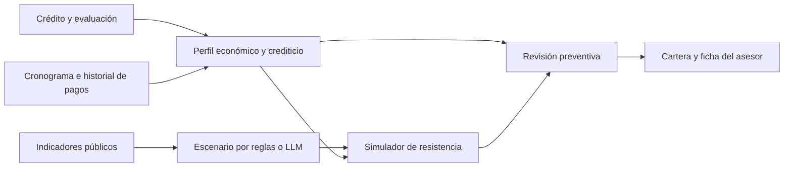

# Arquitectura

## Responsabilidades

| Componente | Entrada | Salida |
| --- | --- | --- |
| Perfil económico y crediticio | Evaluación fechada, cronograma, pagos y contexto | Variables disponibles, antigüedad, indicadores de pago y estimaciones respaldadas. |
| Generación de escenario | Señal pública con alcance y fecha, junto con supuestos permitidos | Rango hipotético por sector, origen y justificación. |
| Simulador | Perfil y escenario | Utilidad estimada, umbrales, sensibilidad y frecuencia de cruce en las muestras. |
| Priorización y revisión | Simulación, señales individuales, exposición y calidad de datos | Motivo de revisión, confianza y verificación sugerida para el asesor. |

El código actual recibe perfiles sintéticos y ya calcula resultados con y sin contexto público. El módulo opcional de lenguaje acepta evidencia pública y devuelve parámetros estructurados. La incorporación de pagos, imputaciones y reglas de priorización de cartera corresponde al siguiente tramo.

## Notas del modelo

- [Capacidad de pago y FCP](Capacidad%20de%20pago%20y%20FCP.md)
- [Historial de pagos e ICCO](Historial%20de%20pagos%20e%20ICCO.md)
- [Perfiles comparables y KNN](Perfiles%20comparables%20y%20KNN.md)
- [Escenarios públicos y LLM](Escenarios%20p%C3%BAblicos%20y%20LLM.md)
- [Simulación Monte Carlo](Simulaci%C3%B3n%20Monte%20Carlo.md)

Consulta el [origen de cada dato](../Datos/Origen%20y%20contrato%20de%20datos.md), el [flujo del asesor](../Producto/Flujo%20del%20asesor.md) y el [estado del desarrollo](../Proyecto/Estado%20y%20hoja%20de%20ruta.md).
